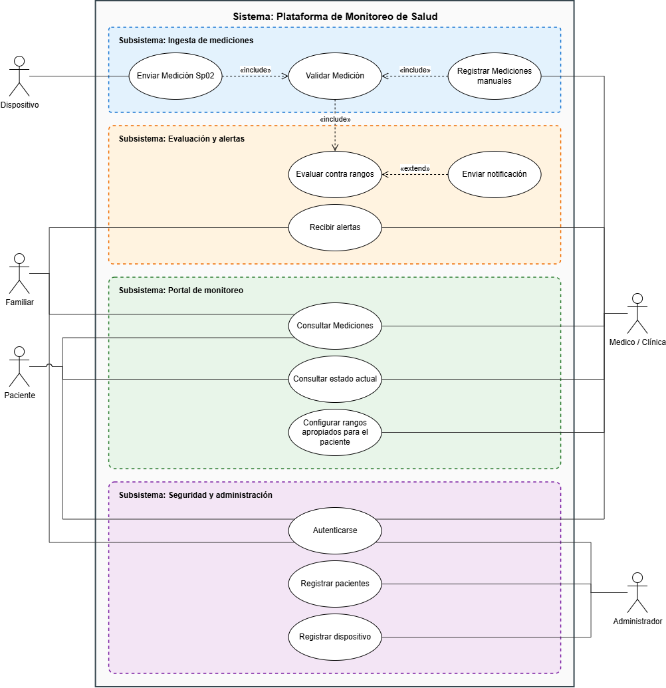
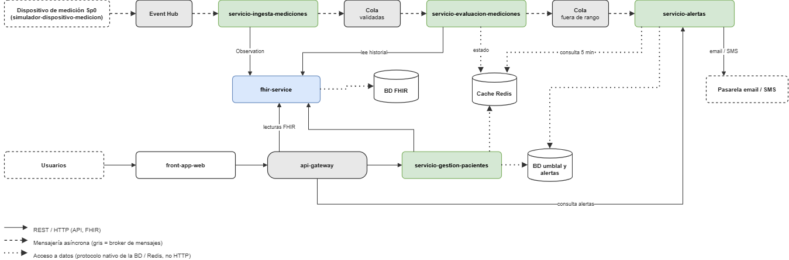

# App de monitoreo y alertas diarias de mediciones personalizada de Salud

**Autor:** _Edgar Camilo Vargas Aldana_ · **Asignatura:** Cloud Computing: Fundamentos e Infraestructuras  
**Estado actual:** Hito 1 — Definición del proyecto, modelo de negocio y arquitectura de referencia

---

## 1. Descripción del dominio

### Problema de negocio

Las clínicas y familiares no pueden realizar seguimiento constante a personas que tienen problemas de salud actualmente, e incluso seguimiento de personas sanas. Y aunque existen dispositivos que realizan la medición por medio de un dispositivo (como reloj inteligente, manilla inteligente de medición de SpO2), actualmente esos datos terminan siendo aislados solamente en aplicacion propetarias y no son compartidos o interoperados con las instituciones o medicos, o personal a cargo del cuidado de la persona.

### Solución

**La App de monitoreo y Alertas** será una plataforma que recibe las mediciones diarias de un reloj, manilla o dispositivo con pulsioxímetro (en forma de eventos), estos eventos son almacenados en formato estándar **HL7 FHIR** (Servidor FHIR Service, el cual es el servidor de persistencia de datos) para que se pueda integrar con las diferentes instituciones o personas autorizadas, así como alertar cuando las mediciones no sean las correctas.

Se tendrá un portal web en el cual se podrá realizar la configuración de los rangos personalizados por persona, que será como la linea base de mediciones para el paciente, y en el cual tambien se podrá revisar cuales han sido las mediciones realizadas.

Se proveerá una API, basado en el estandar de intercambio de datos de salud **HL7 FHIR** que permitirá a las instituciones realizar consumo y ver las lecturas de un rango de fechas especificos, así como agregar via POST alguna medición que no se ha realizado mediante un dispositivo inteligente.

### Casos de uso principales

1. **Enviar medición Sp02:** el reloj (en esta fase, un simulador) envía SpO₂, frecuencia cardíaca y tiempo de uso.
2. **Configurar rangos apropiados para el paciente** por paciente y por condición (por ejemplo, un paciente con EPOC tiene un mínimo de SpO₂ distinto), si no se configura se asume uno genérico predefinido.
3. **Evaluar contra rangos:** Se evalua las mediciones entrantes contra los rangos.
4. **Enviar notificación** y **Recibir alertas:** avisar al familiar y/o medico.
5. **Consultar Mediciones** y **Consultar Estado Actual** de los pacientes y las alertas desde un panel web.

Entre otros que podran verse en la siguiente imagen

### Alcance y limitaciones

- No se realizará por ahora una aplicación con un reloj o dispositivo de medición real. Se **simularan el envío de datos del dispositivo con datos sinteticos**.
- El análisis inicial se basa en **reglas clínicas y umbrales** (explicables y auditables). La inteligencia artificial se contempla como evolución futura, sustituyendo al motor de reglas sin modificar el resto del sistema.

---

## 2. Justificación NIST SP 800-145

| Característica esencial | Cómo la aprovecha la aplicación |
|---|---|
| **Autoservicio bajo demanda** | Se puede aprovisionar la pagina web, el host (si así se desea), la capa de API Gateway, las funciones, alertas y colas, así como provisionar los servicios de computo para un docker HAPI FHIR Service (incluso el servicio PaaS que ofrecen los diferentes proveedores) de forma autonoma, sin depender del proveedor.   A nivel de negocio, una alerta que no llega puede tener consecuencias reales, por lo que se requiere **alta disponibilidad** |
| **Acceso amplio a la red** | El panel web, el reloj y los sistemas externos medicos acceden a los servicios mediante conexiones API REST estándar o de eventos, desde cualquier dispositivo a la plataforma hacia la red. Esto se hará bajo métodos de autenticación para APIs de OAUTH2.0 .|
| **Asignación común de recursos** | Se pueden tener asignación de una maquina física, en la cual pueda ejecutar cada uno de los servicios que ofrece la plataforma de forma independiente, pudiendo compartir inicialmente máquina física, virtualizando para cada uno de los componentes o servicios que ofrece la aplicación. |
| **Rápida elasticidad** | Las mediciones pueden llegar en **ráfagas** (por ejemplo, tras la medición de la mañana del pacientes) y el resto del día el tráfico es mínimo. Así como varias mediciones por segundo de un mismo dispositivo y de un mismo paciente.   El servicio de ingesta de datos deberá escalar horizontalmente durante los picos de mediciones (eventos que llegan de parte de los dispositivos) y se reduce cuando baja la carga. Cada servicio escala de forma independiente. Así como el servicio en donde se van a alojar los datos ( FHIR Service ), que de acuerdo a la cantidad de información que se este ingestando escala horizontal y/o verticalmente. |
| **Servicio medido** | Se factura por uso (eventos procesados, instancias-hora, alertas enviadas) pudiendo se optimos de acuerdo a la capacidad de computo que se requiera. Teniendo en cuenta la elasticidad, puedo que necesite mayor computo en primeras horas de mañana de mayor mediciones, pero a lo largo del resto del día no se ve la misma cantidad de información, permitiendo medir en que momentos se requiere mayor consumo, y basado en esas mediciones escalar o desescalar los recursos |

---

## 3. Mapeo de actores NIST SP 500-292

| Rol | Quién es en este proyecto |
|---|---|
| **Consumidor** | Clínicas, Médicos, Paciente y Familiar que usan la plataforma; el estudiante como gestión y aprovisionamiento de los recursos de nube |
| **Proveedor** | Proveedor cloud (Microsoft Azure) | Ingresos por uso de eventos, cómputo y almacenamiento; asume el coste de la infraestructura |
| **Intermediario (broker)** | Servicios de terceros que integran o agregan: servicio FHIR gestionado, pasarela de mensajería (email/SMS), La UGR contrata con Microsoft y administra los diferentes servicios de computo, incluyendo la gestión de accesos |
| **Auditor** | Auditor externo de seguridad y protección de datos debido a que la información clínica es confidencial |
| **Operador (carrier)** | Operadoras de red e ISP que conectan relojes, usuarios y la nube (Movistar, Orange, etc.) | Coste de conectividad; condiciona la latencia y la disponibilidad |

### Impacto Económico

No es necesario contar con unas capacidades computo inicialmente fuertes, permitiendo que cuando hayan pocos usuarios se puedan gestionar capacidades bajas de computo, y a medida que ingresen nuevos usuarios se pueda escalar. Así como ingresos por el uso de eventos, si durante el fin de semana no hay mediciones, se puede usar poco computo. 

Ya la nube garantiza el coste de conectividad, la latencia y la disponibilidad, sin estar preocupado por dichas configuraciones de red, que pueden ser costosas por temas de canales dedicados, entre otros.

---

## 4. Arquitectura

### Componentes

| Componente | Responsabilidad | Almacenamiento |
|---|---|---|
| [`servicio-ingesta-mediciones`](services/servicio-ingesta-medicamentos) | Recibe mediciones, valida su calidad, las convierte en recursos FHIR para guardarlos y publica un evento | Servidor FHIR |
| [`servicio-evaluacion-mediciones`](services/servicio-evaluacion-mediciones) | Evalúa cada medición frente a los umbrales y la línea base; calcula estado y tendencia; | Caché (Redis) + FHIR (lectura) + DB (umbrales) |
| [`servicio-alertas`](services/servicio-alertas) | Revisa el cache a ver si en los ultimos 5 minutos se genero una medición asociada a ese paciente que no cumpliera el umbral, de ser así se dispara el servicio de alertas. Decide a quién avisar y por qué canal | Base de datos de alertas |
| [`servicio-gestion-pacientes`](services/servicio-gestion-pacientes) | Gestiona pacientes, familiares y umbrales | Servidor FHIR + base de datos |
| [`front-app-web`](frontend) | Aplicación web de seguimiento | App NodeJS |
| [`fhir-service`](services/fhir-service) | Servidor FHIR que permite la gestión de recursos de interoperar con estandar internacional de datos | Docker FHIR Service |
| `api-gateway` | Gestionar seguridad y centralizar los endpoints expuestos a los usuarios de cada uno de los servicios | API Gateway |
| [`simulador-dispositivo-medicion`](simulador-dispositivo) | Genera datos sintéticos del reloj (herramienta de pruebas, no es un microservicio) | — |

Cada servicio se despliega y escala de forma independiente, tiene una única responsabilidad y se comunica con los demás solo mediante API REST o eventos, sin compartir base de datos.

### Diagrama

## 5. Especificación de la API REST

Todas las rutas van bajo `/api/v1`. Se muestra una versión sintética de los endpoints principales. En cada uno de los services se encontrará la especificación.

## 6. Gestión del proyecto

- **Repositorio:** monorepo con un directorio por servicio (`services/`), el frontend y el simulador.
- **Estrategia de ramas:** `main` protegida; el trabajo se integra mediante *feature branches* (`feature/<servicio>-<descripcion>`) y Pull Requests.
- **Commits semánticos:** `feat:`, `fix:`, `docs:`, `refactor:`, con ámbito opcional, por ejemplo `feat(ingestion): valida lecturas fuera de rango`.
- **Tablero:** GitHub Projects con vistas agrupadas por Milestones.
- **Historias de usuario:** registradas como Issues con la etiqueta `user-story`, criterios de aceptación y checklist técnico.
- **Plantillas:** `.github/ISSUE_TEMPLATE/user_story.md` y `.github/PULL_REQUEST_TEMPLATE.md`.

---
