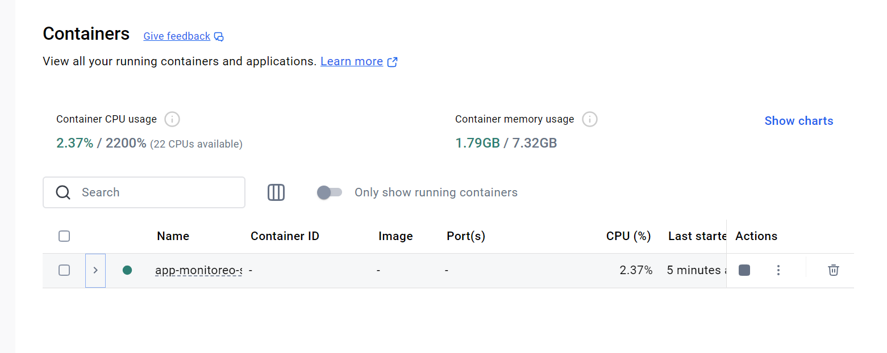
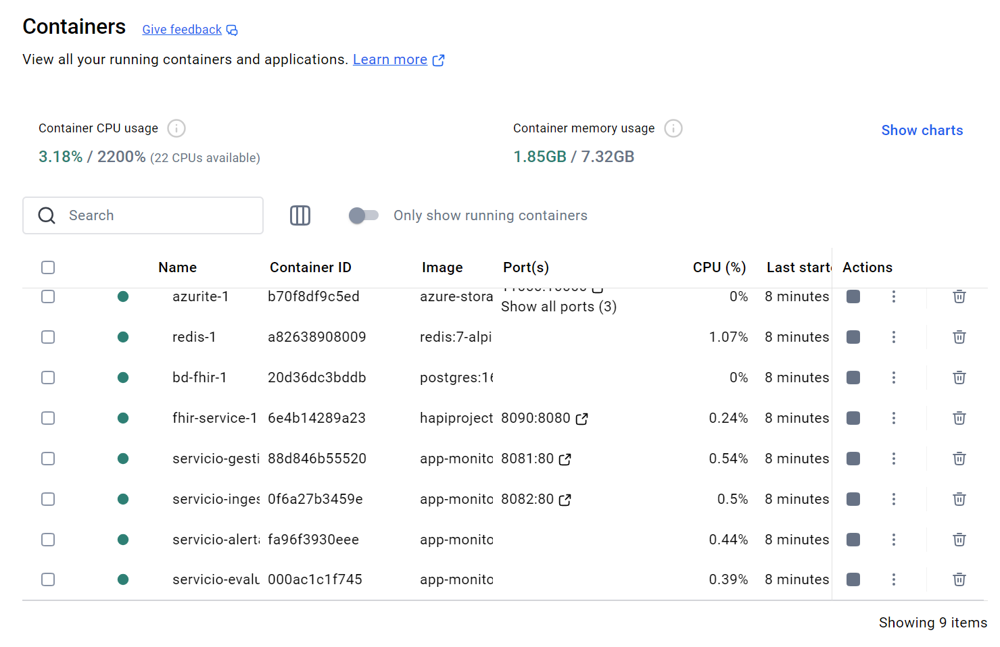
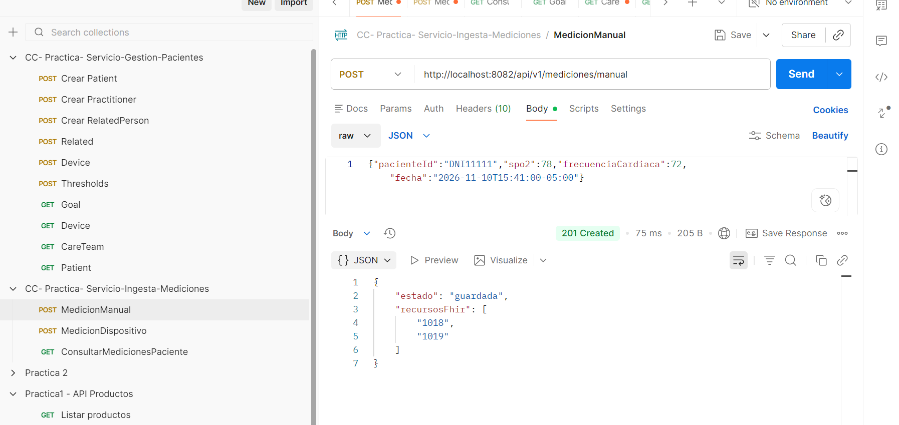
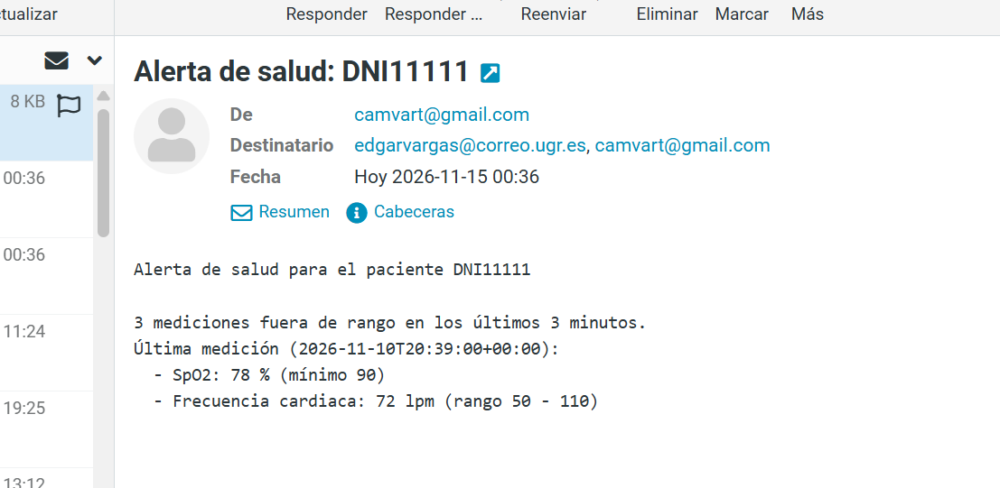

# App de monitoreo y alertas diarias de mediciones personalizada de Salud - Docker Compose (entorno local)

**Autor:** _Edgar Camilo Vargas Aldana_ · **Asignatura:** Cloud Computing: Fundamentos e Infraestructuras

---

## 1. Arquitectura

El archivo `services/docker-compose.yml` levanta todo el entorno local con un único comando: los microservicios propios, los servicios externos que estos necesitan, las bases de datos con almacenamiento persistente y las redes internas.

### Componentes

#### Servicios externos (imágenes oficiales, no tienen código propio)

| Servicio | Imagen | Responsabilidad | Almacenamiento |
|---|---|---|---|
| `bd-fhir` | `postgres:16-alpine` | Base de datos de `fhir-service` | Volumen `bd-fhir-data` |
| `fhir-service` | `hapiproject/hapi` | Servidor FHIR R4 (HAPI) donde se persisten pacientes, grupos, umbrales y mediciones | `bd-fhir` |
| `redis` | `redis:7-alpine` | Caché con el conteo de mediciones fuera de rango por paciente | Volumen `redis-data` (persistencia AOF) |
| `azurite` | `mcr.microsoft.com/azure-storage/azurite` | Emulador de Azure Storage. Aporta las colas de mensajes (`mediciones-ingestadas`, `alertar`) y el almacenamiento que exigen las Azure Functions | Volumen `azurite-data` |

#### Microservicios propios (se construyen desde su `Dockerfile`)

| Servicio | Carpeta | Lenguaje | Responsabilidad |
|---|---|---|---|
| `servicio-gestion-pacientes` | `services/servicio-gestion-pacientes` | C# (Azure Functions, .NET 8) | Gestiona pacientes, familiares, médicos, grupos (`CareTeam`) y umbrales (`Goal`) sobre el servidor FHIR |
| `servicio-ingesta-mediciones` | `services/servicio-ingesta-mediciones` | C# (Azure Functions, .NET 8) | Recibe mediciones, las valida, las guarda como `Observation` y publica un evento en la cola |
| `servicio-evaluacion-mediciones` | `services/servicio-evaluacion-mediciones` | C# (Azure Functions, .NET 8) | Evalúa cada medición contra los umbrales y publica una alerta si hay 3 fuera de rango en 3 minutos |
| `servicio-alertas` | `services/servicio-alertas` | C# (Azure Functions, .NET 8) | Busca el grupo del paciente y envía el correo de alerta a los miembros que tengan email |

### Flujo entre servicios

```
Dispositivo / médico
      │ POST /mediciones/...
      ▼
servicio-ingesta-mediciones ──guarda Observation──► fhir-service ──► bd-fhir
      │ cola "mediciones-ingestadas" (azurite)
      ▼
servicio-evaluacion-mediciones ──umbrales / Observation──► servicio-gestion-pacientes ──► fhir-service
      │ conteo en redis · 3 fuera de rango en 3 min
      │ cola "alertar" (azurite)
      ▼
servicio-alertas ──CareTeam y emails──► servicio-gestion-pacientes ──► SMTP (Gmail) ──► correo
```

## 2. Cómo se construyó el compose

### Estructura de archivos

```
services/
├── docker-compose.yml     # define servicios, redes y volúmenes
├── .env.example           # plantilla de variables (sin credenciales reales)
├── .env                   # variables reales, NO se sube al repositorio
├── servicio-gestion-pacientes/      (Dockerfile propio)
├── servicio-ingesta-mediciones/     (Dockerfile propio)
├── servicio-evaluacion-mediciones/  (Dockerfile propio)
├── servicio-alertas/                (Dockerfile propio)
└── fhir-service/config/hapi.application.yaml   # configuración de HAPI para PostgreSQL
```

### Decisiones de diseño

1. **Servicios externos con imagen oficial, microservicios con `build`.** Los externos usan `image:` y los propios `build: ./<carpeta>`, de modo que `docker compose up --build` compila las cuatro Azure Functions con los mismos Dockerfile que ya se usaban individualmente.
2. **Nombres de servicio como direcciones.** Dentro de las redes de Docker los contenedores se resuelven por nombre. Por eso lo que antes era `host.docker.internal:8081` ahora es `http://servicio-gestion-pacientes/api/v1/`, `redis:6379`, `http://fhir-service:8080/fhir` y los endpoints de Azurite apuntan a `azurite:10000-10002`.
3. **Redes virtuales aisladas.** Hay dos redes:

   | Red | Tipo | Servicios | Para qué |
   |---|---|---|---|
   | `red-datos` | `internal: true` (sin salida a internet ni acceso desde el equipo) | todos | Comunicación inter-contenedor |
   | `red-publica` | bridge normal | `fhir-service`, `azurite`, gestión, ingesta y alertas | Publicar puertos al equipo y dar salida a internet (el SMTP lo necesita) |

   `bd-fhir`, `redis` y `servicio-evaluacion-mediciones` solo están en `red-datos`: no se puede llegar a ellos desde fuera.
4. **Volúmenes gestionados por Docker.** `bd-fhir-data`, `redis-data` y `azurite-data` conservan los datos aunque se reinicien o se eliminen los contenedores. Solo `docker compose down -v` los borra.
5. **Orden de arranque.** `bd-fhir` y `redis` tienen `healthcheck` (`pg_isready` y `redis-cli ping`) y los servicios que dependen de ellos esperan con `depends_on: condition: service_healthy`. `fhir-service` no arranca hasta que la base de datos acepta conexiones.
6. **Clave de las Azure Functions sin archivo.** Antes cada servicio montaba un `secrets-host.json`. Ahora el compose lo genera con `configs: content:` a partir de `FUNCTIONS_MASTER_KEY`, y esa misma variable se envía como `PACIENTES_FUNCTIONS_KEY` a evaluación y alertas. Así hay una única clave y nada que copiar a mano.
7. **Solo se publican los puertos que se usan desde fuera.** Evaluación y alertas se activan por cola y no tienen endpoints HTTP, por lo que no exponen puerto.

### Variables de entorno (`.env.example`)

| Variable | Descripción |
|---|---|
| `FHIR_PORT`, `GESTION_PACIENTES_PORT`, `INGESTA_PORT` | Puertos publicados en el equipo (8090, 8081, 8082) |
| `AZURITE_BLOB_PORT`, `AZURITE_QUEUE_PORT`, `AZURITE_TABLE_PORT` | Puertos de Azurite (11000, 11001, 11002) |
| `HAPI_IMAGE` | Imagen de HAPI FHIR |
| `FHIR_DB_NAME`, `FHIR_DB_USER`, `FHIR_DB_PASSWORD` | Base de datos de `fhir-service` |
| `FUNCTIONS_MASTER_KEY` | Clave enviada en el header `x-functions-key` |
| `AZURITE_CONNECTION` | Conexión a Azurite (cuenta pública de desarrollo de Microsoft) |
| `SMTP_HOST`, `SMTP_PORT`, `SMTP_USER`, `SMTP_PASSWORD` | Correo de `servicio-alertas` (Gmail con contraseña de aplicación) |

Los valores de `.env.example` son de ejemplo. Los reales van solo en `.env`, que está en el `.gitignore`.

## 3. Implementación

### Requisitos

- Docker Desktop en ejecución y Docker Compose 2.23 o superior (necesario para `configs: content:`).
- Una cuenta de Gmail con contraseña de aplicación para el envío de correos.

### Despliegue paso a paso

1. Detén los contenedores que se hayan levantado a mano con los README de cada servicio, para que no ocupen los mismos puertos (`docker rm -f azurite fhir-service bd-fhir ...`).
2. Copia la plantilla y edita los valores:

   ```powershell
   cd services
   copy .env.example .env
   ```

   Define al menos `FHIR_DB_PASSWORD`, `FUNCTIONS_MASTER_KEY`, `SMTP_USER` y `SMTP_PASSWORD`.
3. Levanta todo el entorno con un único comando:

   ```powershell
   docker compose up -d --build
   ```

4. Revisa el estado y espera unos 40 segundos a que HAPI cree sus tablas:

   ```powershell
   docker compose ps
   docker compose logs -f servicio-alertas
   ```

Comandos útiles:

| Comando | Efecto |
|---|---|
| `docker compose down` | Detiene y elimina los contenedores y las redes; **conserva** los volúmenes |
| `docker compose down -v` | Además **borra** los volúmenes (datos de FHIR, Redis y colas) |
| `docker compose up -d --build <servicio>` | Reconstruye y reinicia un solo microservicio |

> **Nota:** Postgres solo aplica `FHIR_DB_USER` y `FHIR_DB_PASSWORD` la primera vez que crea el volumen. Si se cambia la contraseña en el `.env` después, hay que hacer `docker compose down -v` para que `bd-fhir` y `fhir-service` vuelvan a coincidir.

## 4. Pruebas de funcionamiento

### 4.1 Entorno levantado

Con `docker compose up -d --build` se crea el proyecto `app-monitoreo-salud` con sus 8 contenedores:



Todos los servicios quedan en ejecución. Se ven los puertos publicados (8090 FHIR, 8081 gestión de pacientes, 8082 ingesta, 11000-11002 Azurite) y que `redis`, `bd-fhir`, evaluación y alertas no exponen puerto al equipo:



### 4.2 Registro de una medición

Con el paciente, su grupo y el umbral ya creados mediante `servicio-gestion-pacientes`, se envía una medición con SpO2 por debajo del mínimo a `servicio-ingesta-mediciones`. Responde `201 Created` y devuelve los identificadores de las `Observation` guardadas en `fhir-service`, lo que confirma la comunicación entre ingesta, FHIR y PostgreSQL:



### 4.3 Alerta por correo

Tras tres mediciones fuera de rango en menos de 3 minutos, `servicio-evaluacion-mediciones` (usando Redis) publica el mensaje en la cola `alertar` de Azurite y `servicio-alertas` envía un único correo a todos los miembros del grupo del paciente que tienen email. Esto valida el flujo completo entre los 8 contenedores:



## 5. Gestión del proyecto
- **Estrategia de ramas:** `main` protegida; el trabajo se integra mediante *feature branches* (`feature/<servicio>-<descripcion>`) y Pull Requests.
- **Commits semánticos:** `feat:`, `fix:`, `docs:`, `refactor:`, con ámbito opcional, por ejemplo `feat(ingestion): valida lecturas fuera de rango`.
- **Tablero:** GitHub Projects con vistas agrupadas por Milestones.
- **Historias de usuario:** registradas como Issues con la etiqueta `user-story`, criterios de aceptación y checklist técnico.
- **Plantillas:** `.github/ISSUE_TEMPLATE/user_story.md` y `.github/PULL_REQUEST_TEMPLATE.md`.

---
